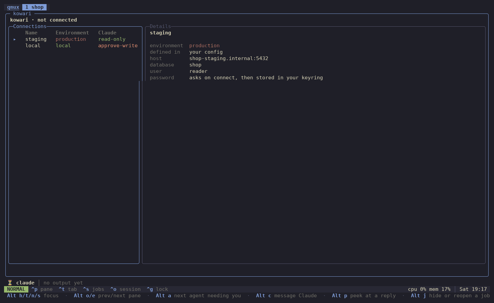

<p align="center"></p>

<h1 align="center">kowari</h1>

A PostgreSQL client for the terminal that sits beside Claude Code. You write and run SQL, browse tables and read results in the TUI; Claude queries the same databases through the `kowari` CLI, and each connection says what Claude may do with it.



*kowari in a komux tab with native Claude docked below. Tab completes the table name, the rows land in the grid, and Enter on a `jsonb` cell opens it as formatted JSON. Then Alt+c asks Claude why one partner's webhooks keep failing. Claude reads the same local database through `kowari query`, read-only, and answers. Waiting on the model is time-lapsed.*

## Setup

```bash
bun install
bun link                                       # puts `kowari` on PATH
kowari setup --yes                             # teaches Claude to use it, and keeps it out of your keyring
```

`kowari setup` lists what kowari adds to Claude Code's config and whether each part is there: the skill, which points Claude at `kowari guide`, linked so it follows this checkout as you update it, and the deny rules that keep keyring tools away from Claude and stop it reading or editing `.kowari.toml` or your kowari config, where its access is granted. `--yes` sets up what is missing. `--remove` takes the skill out again but leaves the deny rules, which only protect you.

## Use

```
kowari                                  open the TUI for this worktree
kowari connections                      list the connections, and what Claude may do with each
kowari query <connection> [sql|-]       run one statement (from stdin when sql is - or missing)
kowari tables <connection>              list tables and views
kowari describe <connection> <table>    columns, constraints, indexes, and foreign keys pointing at a table
kowari guide [page]                     a page of the guide for agents; index links to the rest
kowari setup [--yes|--remove]           list, add, or remove kowari's skill and deny rules in Claude Code's config
```

`-C <dir>` runs as if started in another worktree, `--json` prints JSON, and `--max-rows <n>` changes the 500-row cap. `connections`, `query`, `tables` and `describe` are for Claude and obey the connection's agent level.

Keys: Space opens a menu wherever it isn't text (the editor in normal mode, the tables, the results, the connection screen), and Space ? lists every key for where you are. Space f finds a table by name and selects its first 100 rows; Space c is the connection screen, also on Ctrl-O.

- Connection screen: `↑`/`↓` choose · Enter connect · `r` reload.
- Everywhere in the workspace: Ctrl-Enter or F5 run the statement under the cursor · Tab switch pane · Ctrl-C cancel · Ctrl-Q quit.
- Editor: helix keys, with Ctrl-Space to complete in insert mode, `/` to search the SQL (`n`/`N` for the next and previous match), and `:` for a command line, where `:q` quits.
- Results: `hjkl` or arrows move · Enter opens the cell · `/` searches the cells, highlighting the matches (`n`/`N` step through them, Esc clears) · `y` copies the cell and `Y` the row.

Inside komux, kowari tells komux its keys for where you are, so komux's palette can list and run them.

Inside komux, **Alt+shift+c** opens the message box for the tab's Claude with what you're on attached: the SQL selected in the editor or the statement under the cursor, the table picked in the list, or in the results the statement with the row number, column and table under the grid cursor. kowari never attaches a value from the results, on any connection; Claude reruns the statement with `kowari query` where its access on that connection allows.

## Connections

Connections come from two files, shown together; a name in yours wins.

- `.kowari.toml` at the worktree root: the repo's local databases, with no secrets and no agent levels. Fields can be `${VAR}` or `${VAR:-default}`, filled in from the worktree's `.env`.
- `~/.config/kowari/connections.toml`: your shared databases, and every grant of access to Claude.

```toml
# .kowari.toml
[connections.local-ro]
host = "localhost"
port = "${APP_DB_PORT}"
database = "app"
user = "app_agent_ro"
password = "${APP_AGENT_RO_PASSWORD}"
```

```toml
# ~/.config/kowari/connections.toml
[connections.staging]
host = "app-staging.internal"
database = "app"
user = "reader"
agent = "read-only"

[repos."github.com/example/app"]
local = "approve-writes"
local-ro = "read-only"
```

A connection's fields are `host`, `port`, `database`, `user`, `password`, `sslmode` and `sslrootcert`, with Postgres's defaults for any left out. Without a `password`, the TUI asks for one and keeps it in your system keyring.

Grants are keyed by the repo's origin remote and the connection's name. Claude's level on each connection is one of:

| Level | What Claude can do |
|---|---|
| `none` | Nothing. The default. |
| `read-only` | One read-only statement per call, checked by a parser, run in a read-only transaction that always rolls back, and capped in rows and bytes. A connection whose login role could change the database is refused. |
| `approve-writes` | Reads run; writes are refused until the TUI can approve them. |
| `write` | Statements run as sent. |

`approve-writes` and `write` grants on a repo's connections only hold while the connection points at a local host: `localhost`, a loopback address, a compose service, or a host you list under `[local] hosts` or in the grant itself (`local = { agent = "write", hosts = ["db.internal"] }`). Pointed anywhere else, the connection drops to `none` for Claude, so a repo file can't aim a granted name at a shared database.

## Tests

Tests need Postgres from `scripts/test-db` (on 127.0.0.1:55433, or set `KOWARI_TEST_DATABASE_URL`), then `bun test`.

## The README recording

`scripts/hero-cast` regenerates `docs/kowari.gif`. It runs a real Claude Code session, so each take costs model calls and comes out a little different. It starts a throwaway Postgres in Docker on 127.0.0.1:55435, seeds it from `scripts/hero-fixture/seed.sql`, builds a scratch worktree and config in `/tmp/demo-db`, and runs komux and kowari from the ptyparty checkouts beside this one (`PTYPARTY_DIR` points elsewhere). It drives the session in a pty and draws each frame with Pillow. It needs Docker, `python3`, `fish` and a monospace TTF; pyte and Pillow install into a scratch venv on the first run.

The logo is drawn by `docs/logo.py`: `python3 -I docs/logo.py tall-linedot-colour snug > docs/kowari.svg`.
