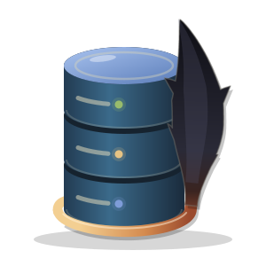

<p align="center"></p>

<h1 align="center">kowari</h1>

A PostgreSQL client for the terminal that sits beside Claude Code. You write and run SQL, browse tables and read results in the TUI; Claude queries the same databases through the `kowari` CLI, and each connection says what Claude may do with it.

## Setup

```bash
bun install
bun link                                       # puts `kowari` on PATH
ln -s "$PWD/skills/kowari" ~/.claude/skills/   # teaches Claude to use it
```

## Use

```
kowari                                  open the TUI for this worktree
kowari connections                      list the connections, and what Claude may do with each
kowari query <connection> [sql|-]       run one statement (from stdin when sql is - or missing)
kowari tables <connection>              list tables and views
kowari describe <connection> <table>    columns, constraints, indexes, and foreign keys pointing at a table
```

`-C <dir>` runs as if started in another worktree, `--json` prints JSON, and `--max-rows <n>` changes the 500-row cap. Every command after the first is for Claude and obeys the connection's agent level.

Keys: `↑`/`↓` choose · Enter connect · `r` reload on the connection screen; then Ctrl-Enter or F5 run the statement under the cursor · Ctrl-Space complete · Tab switch pane · Ctrl-O connections · Ctrl-C cancel · Ctrl-Q quit. The editor uses helix keys.

## Connections

Connections come from two files, shown together; a name in yours wins.

- `.kowari.toml` at the worktree root: the repo's local databases, with no secrets and no agent levels. Fields can be `${VAR}` or `${VAR:-default}`, filled in from the worktree's `.env`.
- `~/.config/kowari/connections.toml`: your shared databases, and every grant of access to Claude.

```toml
# .kowari.toml
[connections.local-ro]
host = "localhost"
port = "${APP_DB_PORT}"
database = "app"
user = "app_agent_ro"
password = "${APP_AGENT_RO_PASSWORD}"
```

```toml
# ~/.config/kowari/connections.toml
[connections.staging]
host = "app-staging.internal"
database = "app"
user = "reader"
agent = "read-only"

[repos."github.com/example/app"]
local = "approve-writes"
local-ro = "read-only"
```

A connection's fields are `host`, `port`, `database`, `user`, `password`, `sslmode` and `sslrootcert`, with Postgres's defaults for any left out. Without a `password`, the TUI asks for one and keeps it in your system keyring.

Grants are keyed by the repo's origin remote and the connection's name. Claude's level on each connection is one of:

| Level | What Claude can do |
|---|---|
| `none` | Nothing. The default. |
| `read-only` | One read-only statement per call, checked by a parser, run in a read-only transaction that always rolls back, and capped in rows and bytes. A connection whose login role could change the database is refused. |
| `approve-writes` | Reads run; writes are refused until the TUI can approve them. |
| `write` | Statements run as sent. |

`approve-writes` and `write` grants on a repo's connections only hold while the connection points at a local host: `localhost`, a loopback address, a compose service, or a host you list under `[local] hosts` or in the grant itself (`local = { agent = "write", hosts = ["db.internal"] }`). Pointed anywhere else, the connection drops to `none` for Claude, so a repo file can't aim a granted name at a shared database.

## Tests

Tests need Postgres from `scripts/test-db` (on 127.0.0.1:55433, or set `KOWARI_TEST_DATABASE_URL`), then `bun test`.

The logo is drawn by `docs/logo.py`: `python3 -I docs/logo.py tall-linedot-colour snug > docs/kowari.svg`.
